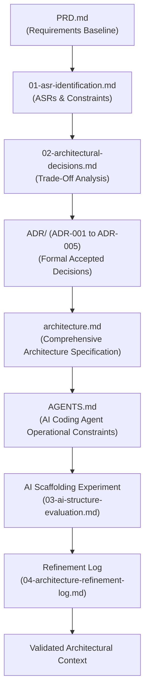

# Deliverable 3 — Architectural Context for AI-Assisted Development
## Human-Controlled Digital-Asset Advisory Application

**Course:** Software Engineering (Fall 2026)  
**Section:** SE-B  
**Team Members:**  
- Muhammad Ahmad (23i-3083)  
- Murtaza Hassan (25i2603)  
**CLO-3:** Critically evaluate and refine an appropriate software architecture based on project requirements and constraints.

---

## 1. Project Overview
The **Human-Controlled Digital-Asset Advisory Application** is an advisory platform built for non-technical retail savers seeking to hedge against currency devaluation through disciplined, conservative digital-asset micro-dosing. 

### Core Product Philosophy:
> **The system is strictly an ADVISORY ASSISTANT, NEVER an autonomous trading bot.**  
> Trade execution requires explicit, per-tranche human authorization using native OS biometrics (Face ID/Touch ID) or PIN within a strict 60-second window. The application contains zero fund-withdrawal or transfer capabilities.

---

## 2. Purpose of Deliverable 3
Deliverable 3 transforms the validated requirements from Deliverable 2 into a formal, human-designed **Architectural Context**. This context defines component boundaries, communication protocols, security barriers, and operational rules, ensuring that AI coding agents in subsequent deliverables can implement the codebase without hallucination, security breaches, or architectural drift.

---

## 3. Directory & File Structure

```
deliverable-3/
├── README.md                                  # Deliverable guide, navigation, and overview
├── PRD.md                                     # Approved baseline requirements from Deliverable 2
├── architecture.md                            # Comprehensive 30-section software architecture specification
├── AGENTS.md                                  # Operational instructions and boundary rules for AI agents
├── ADR/                                       # Architecture Decision Records (ADRs)
│   ├── ADR-001-architecture-style.md          # Modular Monolith with Ports & Adapters selection
│   ├── ADR-002-component-boundaries.md        # 8-module core + 3 TA-provided additions partitioning
│   ├── ADR-003-data-persistence.md            # Single relational DB with logical module ownership
│   ├── ADR-004-authentication-authorization.md# 4-stage auth separation & ephemeral biometric tokens
│   └── ADR-005-external-integrations.md       # Abstracted ports & Transactional Outbox pattern
├── architecture-evidence/                     # Process evidence and evaluation logs
│   ├── 01-asr-identification.md               # 13 ASRs, Non-ASR exclusions, 12 cross-cutting constraints
│   ├── 02-architectural-decisions.md          # Alternatives, trade-offs, and human decisions for D-01 to D-05
│   ├── 03-ai-structure-evaluation.md          # Step 7 evaluation of AI-proposed scaffolding
│   ├── 04-architecture-refinement-log.md      # Step 8 iterative refinements (Redis removal, DB isolation)
│   ├── 05-group-contribution-log.md           # Team participation matrix and oral defense preparation
│   └── 06-ai-agent-interaction-log.md         # Exact prompts, agent responses, and re-evaluation trace
└── diagrams/                                  # Mermaid architecture diagrams
    ├── architecture-context.mmd               # System context and external actors
    ├── component-diagram.mmd                  # Internal 8-module core and TA-provided module boundaries
    ├── trade-auth-flow.mmd                    # Sequence flow of 60s biometric authorization gate
    └── data-flow-diagram.mmd                  # Data movement across modules and storage tables
```

---

## 4. How the Documents Relate to One Another



1. **[PRD.md](PRD.md):** Defines what the product must do, its numerical thresholds, and business rules.
2. **[01-asr-identification.md](architecture-evidence/01-asr-identification.md):** Filters requirements that force structural decisions (ASRs) from local functional details.
3. **[02-architectural-decisions.md](architecture-evidence/02-architectural-decisions.md):** Documents the human team's evaluation of architectural alternatives and trade-offs.
4. **[ADRs](ADR/):** Formal Architecture Decision Records documenting context, options, decisions, rationale, and consequences.
5. **[architecture.md](architecture.md):** Consolidates the complete architecture across 30 comprehensive sections.
6. **[AGENTS.md](AGENTS.md):** Translates the architecture into binding operational instructions, dependency rules, and approval gates for AI coding agents.

---

## 5. How an AI Coding Agent Should Read These Documents
1. **Read `AGENTS.md` First:** Understand the cardinal rules (strictly advisory, zero withdrawals, fail-closed timing) and technology restrictions.
2. **Inspect `architecture.md`:** Study module responsibilities (§12), component boundaries (§13), and sequence flows (§18) before writing code.
3. **Respect Module Isolation:** Never create direct cross-module database imports. Communicate strictly via exported port interfaces.
4. **Adhere to the Source of Truth Hierarchy:** When in doubt, financial safety rules and accepted ADRs override generic framework defaults.

---

## 6. How the Team Performed Architectural Validation
The team executed a rigorous two-round validation experiment:
1. **Initial AI Scaffolding:** Provided `PRD.md`, `architecture.md`, `AGENTS.md`, and the ADRs to an AI coding agent and requested an initial project structure.
2. **Critical Human Evaluation ([03-ai-structure-evaluation.md](architecture-evidence/03-ai-structure-evaluation.md)):** Identified two critical violations—the AI attempted to introduce unapproved Redis infrastructure for scheduling, and placed a shared database client in `common/` that compromised module isolation.
3. **Context Refinements ([04-architecture-refinement-log.md](architecture-evidence/04-architecture-refinement-log.md)):** Updated `AGENTS.md` and `ADR-002`/`ADR-003` to explicitly mandate SQL-based job scheduling and forbid centralized database clients.
4. **Re-Evaluation & Final Verification ([06-ai-agent-interaction-log.md](architecture-evidence/06-ai-agent-interaction-log.md)):** The AI re-evaluated the context and generated a fully compliant project skeleton with zero boundary leaks and zero unapproved dependencies.

---

## 7. Oral Defense & Demonstration Readiness
During the Deliverable 3 demo, **Muhammad Ahmad (23i-3083)** and **Murtaza Hassan (25i2603)** will explain and defend:
- Why a Modular Monolith was selected over Microservices and Serverless (low-latency market checks, transactional consistency).
- How the Zero-Withdrawal rule is guaranteed (pre-storage exchange handshake + complete absence of transfer code).
- How the 60-second authorization cutoff and price-shift locks fail closed.
- How multi-day tranches are scheduled durably using relational tables without Redis.
- The findings from the AI scaffolding experiment and how `AGENTS.md` prevents architectural drift.
