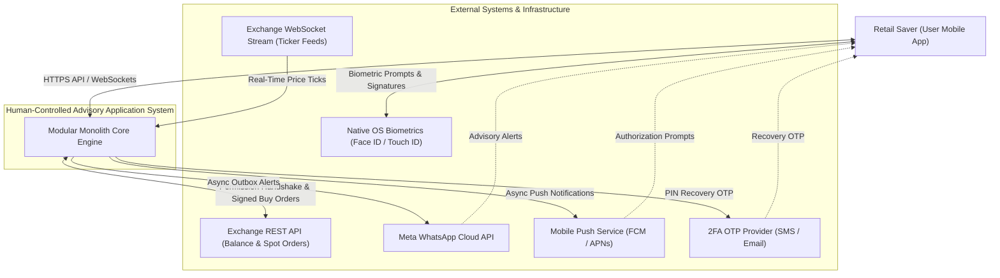
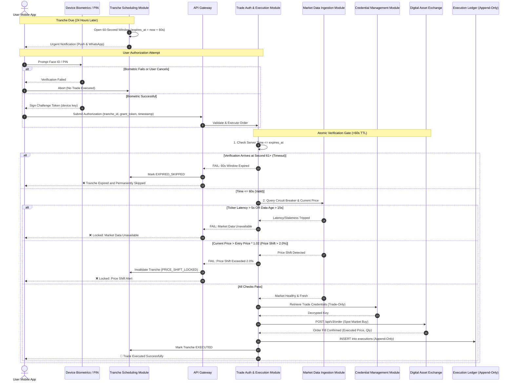

# System Architecture Document
## Human-Controlled Digital-Asset Advisory Application

**Project:** Human-Controlled Digital-Asset Advisory Application  
**Course:** Software Engineering (Section SE-B)  
**Deliverable:** Deliverable 3 — Architectural Context for AI-Assisted Development  
**Team Members:** Muhammad Ahmad (23i-3083) · Murtaza Hassan (25i2603)  
**Status:** Approved Architectural Baseline (Team-Validated)  
**Date:** 15 November 2026  

---

## 1. Document Purpose
This document establishes the official software architecture for the Human-Controlled Digital-Asset Advisory Application. It translates the validated requirements from [PRD.md](PRD.md) into a comprehensive, human-designed architectural context. This context serves as the authoritative boundary specification that governs AI coding agents and human developers in subsequent development stages.

---

## 2. Project Overview
The application is tailored for non-technical retail savers (e.g., salaried workers and small business owners in South Asia) seeking inflation protection through conservative digital-asset exposure. Operating in an environment characterized by severe market volatility, the system emphasizes capital preservation, phased investment entry, transparent bilingual explanations, and strict human oversight.

---

## 3. Product Intent
The product is strictly an **advisory assistant**, **never an autonomous trading bot**. Under no circumstances does the application execute trades automatically, bypass individual order authorizations, or support funds withdrawal/transfer capabilities. Every financial transaction is explicitly initiated and authorized by a human user.

---

## 4. System Scope
- **In-Scope (Approved Baseline):**
  - Continuous ingestion of exchange WebSocket ticker data for conservative assets (BTC, ETH, and top-10 global spot volume).
  - Volatility detection (>5% in 1 hour) and signal generation with bilingual (English/Urdu) explanations.
  - Phased micro-dosing plan creation capped at 5% of total quote capital across three 24-hour tranches.
  - Mandatory per-tranche PIN/biometric authorization with strict 60-second real-time validity windows.
  - Real-time circuit breaking on market data latency (>5s) or staleness (>15s), and price-shift invalidation (>2.0%).
  - Multi-channel asynchronous notification dispatch (WhatsApp and Mobile Push) under a 10-second SLA.
  - Rolling 30-day Signal Accuracy performance measurement against a strict 3% loss limit (reporting-only).
  - Zero-withdrawal exchange API key permission enforcement and encrypted vault storage.
- **In-Scope as TA-Provided Additional Requirements (Deliverable 2 Demo):**
  - Personal digital-asset watchlist (FR-15 TA-Provided).
  - Executed trade history and CSV export (FR-16 TA-Provided).
  - Private investment decision journal (FR-17 TA-Provided).
- **Out-of-Scope (Strict Non-Goals):**
  - Fully automated trading bots or background auto-purchases.
  - Automatic tranche execution upon general plan approval.
  - Fund withdrawals, fiat off-ramping, or external crypto transfers.
  - Automatic stop-loss orders or forced position liquidations.

---

## 5. Architectural Goals
1. **Safety & Zero Autonomous Trading:** Guarantee that no order can be dispatched without verified human authorization.
2. **Deterministic Time-Sensitive Invalidation:** Enforce 60-second authorization windows and sub-second price-shift locks.
3. **Multi-Day State Resilience:** Ensure durable scheduling of 24-hour tranches across host restarts and crashes.
4. **Zero-Trust Credential Security:** Prevent storage or use of API keys with withdrawal capabilities.
5. **Decoupled Asynchronous Reliability:** Isolate external gateway latencies from time-critical core trading paths.

---

## 6. Architectural Drivers
The architecture is directly shaped by five primary drivers:
- **Zero-Trust Security (ASR-06, ASR-08):** Absolute physical/logical isolation of exchange credentials and zero withdrawal capability.
- **Human-in-the-Loop Governance (ASR-01):** Cryptographic verification required per order within a hard 60s TTL.
- **Sub-Second Telemetry (ASR-02, ASR-03, ASR-04):** In-memory sliding ring buffers for tick processing and circuit breaker trip logic.
- **Durable Scheduling (ASR-05):** Database-backed job queue for multi-day plan coordination.
- **Asynchronous Decoupling (ASR-07):** Transactional Outbox pattern satisfying the 95% / 10s notification SLA.

---

## 7. Architecturally Significant Requirements (ASRs)
As approved in [01-asr-identification.md](architecture-evidence/01-asr-identification.md):

| ASR ID | Source Requirements | Summary Description | Priority | Affected Modules |
|---|---|---|---|---|
| **ASR-01** | FR-06, FR-07, BR-03, NFR-02, C-01 | Per-tranche human authorization with strict 60s TTL; late response fails closed. | Critical | Plan Mgmt, Tranche Sched, Trade Auth/Exec |
| **ASR-02** | FR-04, BR-04, BR-05, NFR-01 | Signal expiry (60s), price shift invalidation (>2.0%), atomic validity re-check. | Critical | Advisory, Market Ingestion, Trade Auth/Exec |
| **ASR-03** | FR-04, Resolved OQ-03, NFR-01 | WebSocket ticker ingestion; circuit breaker locks Buy on latency >5s or age >15s. | Critical | Market Ingestion, Trade Auth/Exec |
| **ASR-04** | FR-01, FR-12, BR-07 | 1h volatility (>5%) suppresses new buys and invalidates active signals (AC-12.5). | Critical | Market Ingestion, Volatility, Advisory |
| **ASR-05** | FR-05, FR-06, FR-08–11, C-05 | 24h tranche scheduler, state machine, non-retroactive resume, submitted order safety. | Critical | Plan Mgmt, Tranche Sched, Ledger |
| **ASR-06** | FR-14, BR-11, NFR-02 | Mandatory pre-storage API key permission check; zero withdrawal capability. | Critical | Credential Vault, Trade Execution |
| **ASR-07** | FR-02, NFR-04, C-04 | Asynchronous decoupled dispatch; $\ge 95\%$ provider acceptance in $\le 10$s. | High | User & Notifications, Advisory, Sched |
| **ASR-08** | NFR-02, Resolved OQ-06 | Biometric authorization device-server trust boundary; 2FA OTP PIN recovery. | High | User Auth, Trade Auth/Exec |
| **ASR-09** | FR-13, BR-08, NFR-01 | Rolling 30-day signal accuracy calculation (>3% loss threshold; reporting only). | Medium | Advisory, Signal Analytics |
| **ASR-10** | FR-01, BR-12, Resolved OQ | Conservative asset eligibility checking (BTC, ETH, top-10 volume). | Medium | Volatility & Eligibility, Advisory |
| **ASR-11** | FR-15 (TA-Provided) | User-editable watchlist; reads market data only; strictly isolated from trading. | Medium | Watchlist (TA-Provided), Market Ingestion |
| **ASR-12** | FR-16 (TA-Provided) | Confirmed executed trade history and CSV export; strictly read-only. | Low | Trade History (TA-Provided), Ledger |
| **ASR-13** | FR-17 (TA-Provided) | Private decision journal (CRUD); references plans/signals by ID; zero side effects. | Low | Investment Journal (TA-Provided) |

---

## 8. Architectural Constraints
- **XC-01 (Strict Greater-Than Semantics):** Thresholds trigger only when strictly exceeded ($>2.0\%$, $>5.0\%$, $>3.0\%$).
- **XC-02 (No Autonomous Execution):** Schedulers cannot dispatch trades without verified biometric authorization tokens.
- **XC-03 (Append-Only Ledger):** Executed trade records in `executions` can never be updated or deleted.
- **XC-04 (Zero Withdrawal Capability):** Absolute absence of withdrawal endpoints, methods, or parameters.
- **XC-05 (Server-Side Cutoff):** 60-second authorization timers are evaluated against server-side trusted timestamps.
- **XC-06 (Market Data Lockout):** Stale data ($>15\text{s}$) or ticker lag ($>5\text{s}$) locks Buy immediately.
- **XC-07 (Non-Retroactive Resumption):** Resumed plans schedule from the resume moment forward; no catch-up orders.
- **XC-08 (Open Questions Preserved):** OQ-01, OQ-04, OQ-05, OQ-07, OQ-08, OQ-09 remain open and unassumed.
- **XC-09 (Urdu Translation Fallback):** Urdu translation failure dispatches English with approved fallback notice immediately.
- **XC-10 (Provider Acceptance $\neq$ Device Delivery):** Status reflects gateway provider acceptance only.
- **XC-11 (Unverifiable Key Inactivation):** If permissions cannot be verified, the key remains inactive.
- **XC-12 (3% Loss Limit Measurement-Only):** Under no circumstances does the 3% loss limit trigger an operational stop-loss.

---

## 9. Selected Architectural Style
**Modular Monolith with Ports & Adapters (Hexagonal Architecture) and an Event-Driven Core** ([ADR-001](ADR/ADR-001-architecture-style.md)).

---

## 10. Rationale for the Architectural Style
- **Sub-Millisecond In-Memory Guards:** Eliminates inter-service network latency for circuit breaking and price-shift checks.
- **Transactional Consistency:** Supports single-database ACID transactions across plans, tranches, and outbox queues.
- **Maintainability & AI Governance:** Provides unified codebase context with strict package visibility rules, preventing AI coding agent drift while maintaining clean domain boundaries.

---

## 11. Major Components / Modules
The core architecture consists of **8 medium-grained modules**, complemented by **3 isolated TA-provided additional modules**:
1. `market_ingestion`
2. `volatility_eligibility`
3. `advisory_engine`
4. `plan_management`
5. `tranche_scheduling`
6. `trade_execution`
7. `credential_management`
8. `user_notifications`
9. `watchlist` *(TA-Provided — FR-15)*
10. `trade_history` *(TA-Provided — FR-16)*
11. `investment_journal` *(TA-Provided — FR-17)*

---

## 12. Responsibilities of Each Component
- **`market_ingestion`:** Persistent WebSocket connection lifecycle; heartbeat monitoring; latency ($>5\text{s}$) and staleness ($>15\text{s}$) tracking; 1-hour circular price buffer; event publishing.
- **`volatility_eligibility`:** Rolling 1-hour percentage delta calculation; eligibility verification (BTC/ETH/top-10); volatility warning flags.
- **`advisory_engine`:** Algorithmic signal creation; bilingual explanation formatting; price-shift validation ($>2.0\%$); 30-day cohort Signal Accuracy calculations.
- **`plan_management`:** Plan Lifecycle FSM; 5% quote capital cap validation; 3-tranche division and round-down arithmetic; Pause/Cancel/Restart coordination.
- **`tranche_scheduling`:** Database-backed 24-hour job queue; 60-second authorization window lifecycle; atomic timeout invalidation; duplicate prevention.
- **`trade_execution`:** Biometric grant token validation; pre-dispatch safety checks; exchange REST spot order placement; immutable ledger recording.
- **`credential_management`:** API key ingestion; live external permission verification (rejects withdrawal keys); AES-256-GCM encryption.
- **`user_notifications`:** User management; 2FA OTP generation and delivery; Transactional Outbox worker pool dispatching to WhatsApp and Push gateways.
- **`watchlist` (TA-Provided):** User-managed asset list; real-time price consumption; read-only display.
- **`trade_history` (TA-Provided):** Date-filtered read queries against ledger; CSV formatting and file export.
- **`investment_journal` (TA-Provided):** CRUD for personal user notes linked to plan/signal IDs for display context.

---

## 13. Component Boundaries & Restrictions
- `plan_management` must NEVER access `credential_management` or dispatch trades.
- `tranche_scheduling` must NEVER dispatch orders directly; it only opens authorization windows.
- `trade_execution` can only execute orders when presented with an unexpired, cryptographically valid authorization grant token.
- `credential_management` contains zero methods, endpoints, or data fields for withdrawals or transfers.
- `watchlist`, `trade_history`, and `investment_journal` are strictly isolated: they have zero write or trigger paths to trading.

---

## 14. Interfaces and Communication
- **Synchronous Port Interfaces:** Cross-module queries (e.g., `IMarketDataPort.getCurrentPrice()`, `IExecutionVaultPort.verifyPermissions()`) use strongly-typed in-memory port contracts.
- **Asynchronous Event Bus:** Used for decoupled broadcast notifications within the process (`PriceShiftDetectedEvent`, `MarketDataUnavailableEvent`, `VolatilityWarningEvent`, `SignalGeneratedEvent`).
- **External Adapters:** Dedicated HTTP/WebSocket adapters translate internal port requests to exchange and notification endpoints.

---

## 15. Important Data Responsibilities
Data persistence is handled by a **Single Relational Database with Enforced Logical Module Ownership** ([ADR-003](ADR/ADR-003-data-persistence.md)):
- `users`, `user_credentials`, `otp_records` ➔ `user_notifications`
- `exchange_api_keys` (encrypted AES-256-GCM) ➔ `credential_management`
- `advisory_signals`, `signal_accuracy_records` ➔ `advisory_engine`
- `investment_plans` (with `version_id`) ➔ `plan_management`
- `tranches` (with `version_id`), `authorization_windows` ➔ `tranche_scheduling`
- `trade_authorizations`, `executions` (strictly **APPEND-ONLY**) ➔ `trade_execution`
- `notifications_outbox` ➔ `user_notifications`
- `watchlist_entries` ➔ `watchlist` (TA-Provided)
- `journal_notes` ➔ `investment_journal` (TA-Provided)

---

## 16. External Systems & Integration Boundaries
1. **Digital Asset Exchange (WebSocket):** Real-time ticker stream via `IMarketDataFeedPort`. Trips circuit breaker on latency $>5$s or staleness $>15$s (OQ-01 open).
2. **Digital Asset Exchange (REST):** Spot trading via `IExchangeTradingPort`. Exposes strictly: `verifyPermissions()`, `getQuoteBalance()`, `placeSpotMarketBuy()`. Zero withdrawal methods (XC-04).
3. **WhatsApp Business Cloud API:** Asynchronous alert dispatch via outbox worker pool (5s HTTP timeout).
4. **Mobile Push Gateway (FCM/APNs):** Asynchronous push dispatch with deep-linking to authorization modals.
5. **OTP Delivery Provider:** SMS/Email gateway for PIN recovery via `IOTPDeliveryPort` owned by `user_notifications`.
6. **Device Operating System Biometrics:** Native LocalAuthentication / BiometricPrompt producing device-signed authorization tokens.

---

## 17. Security Architecture
- **Zero-Trust Credential Vault:** Keys are verified with exchange APIs before storage. Keys with withdrawal permissions are unconditionally rejected (XC-11).
- **Zero-Codebase Withdrawal Guarantee:** The system contains zero withdrawal methods, endpoints, or data models (XC-04).
- **Ephemeral Order Grant Tokens:** Biometric authentication unlocks a device-bound key to sign an ephemeral token (`tranche_id`, `expires_at`). Server validates signature and enforces `now() <= expires_at` before decrypting trading keys.
- **2FA OTP Recovery:** PIN recovery requires two-factor verification sent to registered contact info (Resolved OQ-06).

---

## 18. Trade Authorization Workflow
1. At scheduled 24-hour mark, `tranche_scheduling` verifies quote balance and opens a 60s authorization window (`expires_at = now + 60s`).
2. Urgent push and WhatsApp notifications are enqueued via outbox.
3. User opens in-app authorization modal and authenticates via native biometrics / PIN.
4. Client submits authorization payload (`tranche_id`, `grant_token`, `timestamp`).
5. `trade_execution` evaluates:
   - Server clock: `now <= expires_at` (fails closed at second 61).
   - Market data health: latency $\le 5$s, staleness $\le 15$s.
   - Price shift: current price $\le$ entry price $\times 1.02$.
6. If all pass, `trade_execution` signs and posts a spot market buy order to the exchange.
7. Fill confirmation is appended to `executions` and tranche marked `EXECUTED`.

---

## 19. Advisory Signal Lifecycle
`DRAFT` ➔ `ACTIVE (60s TTL)` ➔ `EXPIRED` | `PRICE_SHIFT_INVALIDATED` | `VOLATILITY_INVALIDATED` | `SUPERSEDED`.
- Active signals are invalidated immediately if an upward price surge $> 2.0\%$ occurs or if asset volatility exceeds 5% in 1 hour (AC-12.5).

---

## 20. Investment Plan & Tranche Lifecycle
- **Plan FSM:** `CREATED` ➔ `ACTIVE` ➔ `PAUSED` ➔ `CANCELLED` | `COMPLETED`.
- **Tranche FSM:** `SCHEDULED` ➔ `PENDING_AUTHORIZATION (60s TTL)` ➔ `AUTHORIZED` ➔ `EXECUTING` ➔ `EXECUTED` | `EXPIRED_SKIPPED` | `INSUFFICIENT_FUNDS_SKIPPED` | `CANCELLED`.
- **Race Condition Handling (HV-08):** If user triggers Pause/Cancel while an authorization prompt is open, the window is revoked immediately. If an order was already submitted to the exchange, it may complete; subsequent tranches are paused/cancelled. Resuming never executes missed tranches retroactively (XC-07).

---

## 21. Notification Workflow
- Core modules write notification tasks atomically to `notifications_outbox`.
- Background worker pool dequeues tasks and dispatches via HTTPS with 5s timeouts.
- Provider acceptance timestamps are logged separately per channel to verify the 95% / 10s SLA.
- If Urdu translation is unavailable, dispatch proceeds immediately with English and the fallback notice (XC-09).

---

## 22. Watchlist Workflow (TA-Provided — FR-15)
- User adds/removes assets from their personal watchlist.
- Module queries `market_ingestion` read-only for latest price, 24h delta, and update timestamp.
- Completely isolated from trading and plans; contains zero trade trigger capabilities.

---

## 23. Trade History and CSV Export Workflow (TA-Provided — FR-16)
- User selects date range.
- Module executes read-only query against `executions` table.
- Formats confirmed trades into CSV (asset, date/time, qty, price, total, plan ID) and streams download.
- Zero mutation capabilities against portfolio or ledger.

---

## 24. Investment Decision Journal Workflow (TA-Provided — FR-17)
- User performs CRUD operations on private journal notes (title, text, timestamp).
- Notes reference signal or plan IDs for contextual display only.
- Module has zero dependencies on trade authorization or execution logic.

---

## 25. Error and Failure Handling Principles
- **Fail-Closed Default:** Any uncertainty, network timeout, late biometric arrival (>60s), or stale feed locks authorization.
- **Circuit Breaker:** Automatic lockout ("Market Data Unavailable") on WebSocket latency > 5s or staleness > 15s.
- **Bounded Notification Retries:** No continuous retries that consume the 60-second signal window.

---

## 26. Important Architectural Assumptions
1. Mobile devices possess hardware-backed cryptographic storage (iOS Secure Enclave / Android TEE) for biometric key binding.
2. Supported exchanges offer WebSocket ticker feeds and spot market buy endpoints with quote-asset order sizing.
3. System host maintains clock synchronization via NTP within 50ms drift.

---

## 27. Unresolved Architectural Questions (Preserved Open)
- **OQ-01:** Target exchange(s) for initial release (abstracted via `IExchangeTradingPort`).
- **OQ-04:** Extended exchange outage handling beyond immediate circuit breaker lockout.
- **OQ-05:** Precise resumption timestamp calculation details beyond the confirmed non-retroactive rule.
- **OQ-07:** Local-language audio summaries (kept strictly out of initial scope).
- **OQ-08:** Exact user-facing historical record format for Signal Accuracy reporting.
- **OQ-09:** Quantitative accessibility and usability metrics beyond confirmed NFRs.

---

## 28. Architecture Diagrams

### A. System Context Diagram


### B. Component Diagram
```mermaid
flowchart TD
    subgraph ModularMonolith ["Modular Monolith (Hexagonal Architecture)"]
        subgraph MarketDomain ["Market & Risk Domain"]
            M1["1. Market Data Ingestion Module"]
            M2["2. Volatility & Eligibility Module"]
        end

        subgraph AdvisoryDomain ["Advisory Domain"]
            M3["3. Advisory Signal Module"]
        end

        subgraph PlanDomain ["Plan & Scheduling Domain"]
            M4["4. Plan Management Module"]
            M5["5. Tranche Scheduling Module"]
        end

        subgraph ExecutionDomain ["Security & Execution Domain"]
            M6["6. Trade Authorization & Execution Module"]
            M7["7. Credential Management Module"]
        end

        subgraph UserDomain ["User & Communication Domain"]
            M8["8. User, Auth & Notification Module"]
        end

        subgraph TADomain ["TA-Provided Additions (Isolated from Trading)"]
            M9["9. Watchlist Module (FR-15)"]
            M10["10. Trade History Module (FR-16)"]
            M11["11. Investment Journal Module (FR-17)"]
        end
        
        EventBus[["In-Process Event Bus"]]
    end

    M1 -->|Price Updates & Circuit Breaker Events| EventBus
    EventBus --> M2
    EventBus --> M3
    EventBus --> M6
    
    M2 -->|Eligibility & Suppression State| M3
    M3 -->|Signal Generated Event| M8
    
    M4 -->|Plan Setup (Zero Trades)| M5
    M5 -->|Open 60s Window Event| M8
    
    M5 -.->|Tranche Auth Request| M6
    M6 -->|Validate Token & Decrypt Key| M7
    
    M1 -.->|Market Ticks (Read-Only)| M9
    M6 -.->|Confirmed Trades (Read-Only)| M10
    M4 -.->|Plan IDs (Context Link Only)| M11
    M3 -.->|Signal IDs (Context Link Only)| M11
```

### C. Trade Authorization & Execution Flow


### D. Data Flow Diagram
```mermaid
flowchart LR
    subgraph ExternalSources ["External Feeds & Systems"]
        ExWS["Exchange WebSocket"]
        ExREST["Exchange REST API"]
        ExtUser["User Mobile Device"]
        MetaWA["Meta WhatsApp API"]
        FCM["Firebase Cloud Messaging"]
    end

    subgraph AppModules ["System Modules"]
        M_Market["Market Data Ingestion"]
        M_Vol["Volatility & Eligibility"]
        M_Adv["Advisory Signal"]
        M_Plan["Plan Management"]
        M_Sched["Tranche Scheduling"]
        M_Exec["Trade Execution & Auth"]
        M_Vault["Credential Management"]
        M_Notify["User & Notification"]
    end

    subgraph RelationalDB ["Shared Relational Database (Enforced Module Ownership)"]
        T_Keys[("exchange_api_keys")]
        T_Plans[("investment_plans")]
        T_Tranches[("tranches")]
        T_Signals[("advisory_signals")]
        T_Exec[("executions (Append-Only)")]
        T_Outbox[("notification_outbox")]
    end

    ExWS -->|Raw Ticks| M_Market
    M_Market -->|Clean Ticks & Staleness| M_Vol
    M_Market -->|Fresh Price Snapshots| M_Adv
    M_Market -->|Price Check at Auth| M_Exec

    M_Vol -->|Suppression Flag| M_Adv
    M_Adv -->|Store Signals| T_Signals
    M_Adv -->|Enqueue Alerts| T_Outbox

    ExtUser -->|Setup Plan (5% Cap)| M_Plan
    M_Plan -->|Store Plan| T_Plans
    M_Plan -->|Schedule 3 Tranches| M_Sched
    M_Sched -->|Store Tranches| T_Tranches
    M_Sched -->|Enqueue Prompts| T_Outbox

    T_Outbox -->|Async Dequeue| M_Notify
    M_Notify -->|HTTPS <= 5s| MetaWA
    M_Notify -->|HTTPS <= 5s| FCM

    ExtUser -->|Biometric Grant Token| M_Exec
    ExtUser -->|API Key (No Withdrawals)| M_Vault
    M_Vault <-->|Permission Handshake| ExREST
    M_Vault -->|Encrypted Key| T_Keys

    M_Exec -->|Validate TTL & Shift| T_Tranches
    M_Exec <-->|Fetch Trade Key| M_Vault
    M_Exec -->|Signed Buy Order| ExREST
    M_Exec -->|Record Fill| T_Exec
```

---

## 29. ADR References
- [ADR-001: Overall Architectural Style](ADR/ADR-001-architecture-style.md)
- [ADR-002: Component and Module Boundaries](ADR/ADR-002-component-boundaries.md)
- [ADR-003: Data Persistence and Schema Ownership](ADR/ADR-003-data-persistence.md)
- [ADR-004: Authentication and Trade Authorization Boundary](ADR/ADR-004-authentication-authorization.md)
- [ADR-005: External Integration Boundaries and Decoupled Messaging](ADR/ADR-005-external-integrations.md)

---

## 30. Requirements Traceability Matrix

| PRD Req ID | ASR ID | Architectural Decision | Implementing Component | Test / Verification Rule |
|---|---|---|---|---|
| **FR-01** | ASR-04, ASR-10 | D-01, D-02 | `advisory_engine`, `volatility_eligibility` | Verify BTC/ETH/top-10 eligibility; suppress on move $>5\%$ in 1h. |
| **FR-02** | ASR-07 | D-05 | `user_notifications` | Verify $\ge 95\%$ provider acceptance within 10s over 1,000 test dispatches. |
| **FR-03** | XC-09 | D-05 | `advisory_engine`, `user_notifications` | Dispatch English + fallback text if Urdu translation fails. |
| **FR-04** | ASR-02, ASR-03 | D-01, D-05 | `market_ingestion`, `trade_execution` | Test 60s expiry; strict $>2.0\%$ price shift lock; latency $>5$s lock. |
| **FR-05** | ASR-05 | D-02 | `plan_management` | Verify 5% cap on exchange quote balance; 3 tranches rounded down. |
| **FR-06** | ASR-01 | D-04 | `tranche_scheduling`, `trade_execution` | Verify each tranche requires PIN/biometric auth; plan setup executes 0 trades. |
| **FR-07** | ASR-01 | D-02, D-04 | `tranche_scheduling` | Verify unapproved tranche expires and skips permanently; no late execution. |
| **FR-08** | ASR-05 | D-02, D-03 | `plan_management` | Verify Pause/Cancel preserves executed tranches; revokes open prompts. |
| **FR-09** | ASR-05 | D-02 | `plan_management` | Test Pause revokes active 60s prompt; Resume schedules next 24h forward. |
| **FR-10** | ASR-05 | D-02 | `plan_management`, `trade_execution` | Submitted order completes; unexecuted tranches deleted permanently. |
| **FR-11** | ASR-05 | D-02 | `plan_management` | Recalculate fresh 3 tranches using current balance; 5% cap applies. |
| **FR-12** | ASR-04 | D-01, D-02 | `volatility_eligibility` | Test $>5\%$ move triggers warning and invalidates active signals (AC-12.5). |
| **FR-13** | ASR-09 | D-02 | `advisory_engine` | Test rolling 30-day cohort accuracy; $>3\%$ drop counts as loss (no stop-loss). |
| **FR-14** | ASR-06 | D-02, D-05 | `credential_management` | Live exchange handshake rejects keys with withdrawal rights; zero transfer code. |
| **FR-15** (TA-Provided) | ASR-11 | D-02 | `watchlist` | Editable user watchlist; read-only market feed; zero trade trigger capabilities. |
| **FR-16** (TA-Provided) | ASR-12 | D-02 | `trade_history` | Read-only ledger queries; date-filtered CSV export; zero mutation routes. |
| **FR-17** (TA-Provided) | ASR-13 | D-02 | `investment_journal` | User note CRUD; references plan/signal IDs for display; zero operational side effects. |
| **NFR-01** | ASR-02, ASR-03 | D-01 | `market_ingestion`, `trade_execution` | 100% enforcement of 60s expiry, $>2.0\%$ price shift lock, 5% allocation cap. |
| **NFR-02** | ASR-01, ASR-06 | D-04, D-05 | `credential_management`, `trade_execution` | 100% per-tranche authorization; 0% acceptance of withdrawal-enabled API keys. |
| **NFR-03** | XC-09 | D-05 | `advisory_engine`, `user_notifications` | 100% of signals contain English + Urdu explanations (or approved fallback). |
| **NFR-04** | ASR-07 | D-05 | `user_notifications` | $\ge 95\%$ provider acceptance within 10s across WhatsApp and Mobile Push. |
